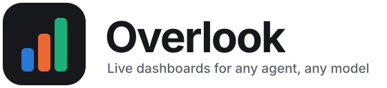
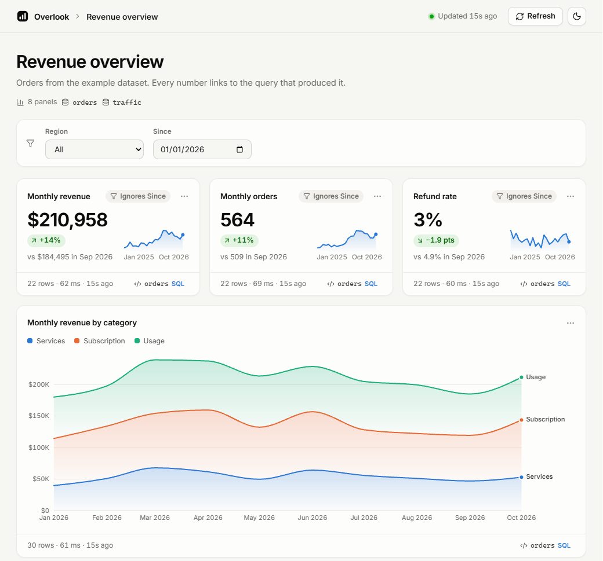

<p align="center">
  <picture>
    <source media="(prefers-color-scheme: dark)" srcset="docs/assets/logo-dark.svg">
    
  </picture>
</p>

<p align="center">
  <b>Say "make a dashboard of my data". Get a live dashboard in your browser.</b><br>
  Works in any AI coding agent, with any model. Your data never leaves your machine.
</p>

<p align="center">
  <a href="https://www.npmjs.com/package/overlook-dash"></a>
  <a href="https://github.com/furkancodes/overlook/actions/workflows/ci.yml"></a>
  
  <a href="LICENSE"></a>
</p>

<p align="center">
  <picture>
    <source media="(prefers-color-scheme: dark)" srcset="docs/assets/dashboard-dark.png">
    
  </picture>
</p>

## Install

You need [Node.js 22](https://nodejs.org) or later. Then run one command:

```bash
npx overlook-dash setup
```

It finds the AI agents on your computer and adds Overlook to each one. Restart
your agent and you're done.

<details>
<summary><b>Claude Code: install as a plugin instead</b></summary>

```text
/plugin install overlook --marketplace furkancodes/overlook
```

This also adds a `/overlook:dashboard` command. Use the plugin or `setup`, not
both.

</details>

<details>
<summary><b>Set it up by hand, or in another agent</b></summary>

Overlook is a standard MCP server. Point any MCP client at:

```text
npx -y overlook-dash mcp
```

For example, in Cursor (`~/.cursor/mcp.json`):

```json
{ "mcpServers": { "overlook": { "command": "npx", "args": ["-y", "overlook-dash", "mcp"] } } }
```

`npx overlook-dash setup --print` shows the exact entry for every supported
agent.

</details>

**Works with:**

*   Claude Code, Claude Desktop, Codex, Cursor, Windsurf, Gemini CLI,
    VS Code (Copilot), OpenCode, Cline and Zed;
*   any other MCP client;
*   any agent that can run a shell command, through `overlook auto`.

## Use it

Open your agent in any project that has data, and say:

> **make a dashboard of my data**

Overlook finds the data, builds a dashboard, checks every number, and opens it
in your browser. Then keep talking to it:

| You say | What happens |
| :--- | :--- |
| *make a dashboard of my data* | A full overview: KPIs with trends, a trend chart, breakdowns and a summary table |
| *show monthly revenue by region from sales.csv* | Exactly the charts you asked for |
| *add a filter for country* | The open page updates by itself |
| *turn the bar chart into a table* | Change any panel in plain words |
| *what dashboards do I have?* | Every saved dashboard with its link |

No MCP in your agent? Run this in the project folder instead:

```bash
npx overlook-dash auto
```

## Features

*   ✨ **One sentence, whole dashboard.** No config files, no spec writing.
    Even small models manage it in one step.
*   🔌 **Any agent, any model.** Claude, GPT, Gemini, Qwen, Llama, or anything
    else that can call tools.
*   🗂️ **Any data.**
    *   CSV, Parquet, JSON, SQLite and DuckDB.
    *   Postgres and MySQL from your `.env` (experimental).
    *   Your agent finds the data in the project for you.
*   ✅ **Checked before you see it.** Every query runs before a dashboard is
    saved. Mistakes go back to the model as a numbered list of fixes.
*   🔍 **Every number shows its source.** One click shows the SQL behind any
    chart, and the data under it as a table.
*   📊 **Real dashboard features.**
    *   KPI tiles with trends and comparisons.
    *   Line, area, bar, scatter and table panels.
    *   Filters, hover tooltips and CSV export.
*   🌗 **Looks good everywhere.** Light and dark themes, color-blind-safe
    charts, and phone layouts.
*   🔒 **Private by design.**
    *   Your data is read in place, read-only.
    *   The page is served from `127.0.0.1` only.
    *   Nothing is uploaded and no CDN is used.

## Your data

Inside a project, there is nothing to add. Your agent finds the data files and
`.env` database URLs there itself, and most agents ask you before adding one.
For data anywhere else:

```bash
npx overlook-dash source add sales ~/Downloads/sales.csv
```

| Data | Example |
| :--- | :--- |
| CSV, TSV, Parquet, JSON (or a glob) | `source add orders "./data/*.parquet"` |
| SQLite, DuckDB | `source add shop ./shop.db` |
| Postgres, MySQL (experimental) | `source add app --env DATABASE_URL` |

## Commands

| Command | What it does |
| :--- | :--- |
| `overlook setup` | Add Overlook to your agents |
| `overlook auto [file]` | Build a dashboard from the data and open it |
| `overlook source add <name> <path>` | Add data from anywhere |
| `overlook open <name>` | Open a saved dashboard |
| `overlook doctor` | Check that everything works |
| `overlook stop` | Stop the dashboard server |

Run commands with `npx overlook-dash <command>`, or install it once with
`npm i -g overlook-dash` and use `overlook <command>`.

## Questions

<details>
<summary><b>Does my data get uploaded anywhere?</b></summary>

No. Overlook reads your files where they are and serves the dashboard from your
own machine. Your AI model sees only what the tools return to it: column names,
a few sample rows, and query results. Run with `OVERLOOK_SAMPLES=0` to leave
out sample rows.

</details>

<details>
<summary><b>The browser didn't open</b></summary>

Your agent still prints the link, usually `http://127.0.0.1:4777/d/<name>`.
Overlook doesn't open a browser in CI, over SSH, or with `OVERLOOK_OPEN=0`.

</details>

<details>
<summary><b>The link stopped working</b></summary>

The dashboard server stopped (for example after a restart). Run
`npx overlook-dash open <name>`, which restarts the server and opens the
dashboard.

</details>

<details>
<summary><b>Port 4777 is already in use</b></summary>

Set another port with `OVERLOOK_PORT=4800`, or put `"port": 4800` in
`~/.overlook/config.json`.

</details>

<details>
<summary><b>The tools show up twice in Claude Code</b></summary>

You have both the plugin and the `setup` entry. Remove one with
`claude mcp remove overlook`, or uninstall the plugin.

</details>

<details>
<summary><b>Something else is wrong</b></summary>

Run `npx overlook-dash doctor`. It checks Node, your data sources and the
server. Then [open an issue](https://github.com/furkancodes/overlook/issues)
with its output.

</details>

## Learn more

*   **[Guide](docs/GUIDE.md):** every agent, data source, tool and setting, the
    dashboard spec, and the security model.
*   **[Changelog](CHANGELOG.md):** what's in each release, and what's
    experimental.
*   **[Security](SECURITY.md):** how to report a vulnerability.
*   **[Design](docs/designs/overlook.md):** why Overlook works the way it does.

## Contributing

```bash
git clone https://github.com/furkancodes/overlook && cd overlook
```

```bash
npm install
```

```bash
npm test
```

Issues and pull requests are welcome. [The guide](docs/GUIDE.md#development)
covers the demo, the benchmarks and the model eval.

## License

MIT. Bundled third-party components are listed in
[THIRD_PARTY_NOTICES.md](THIRD_PARTY_NOTICES.md). Overlook is an independent
project and is not affiliated with Anthropic or any model provider.
